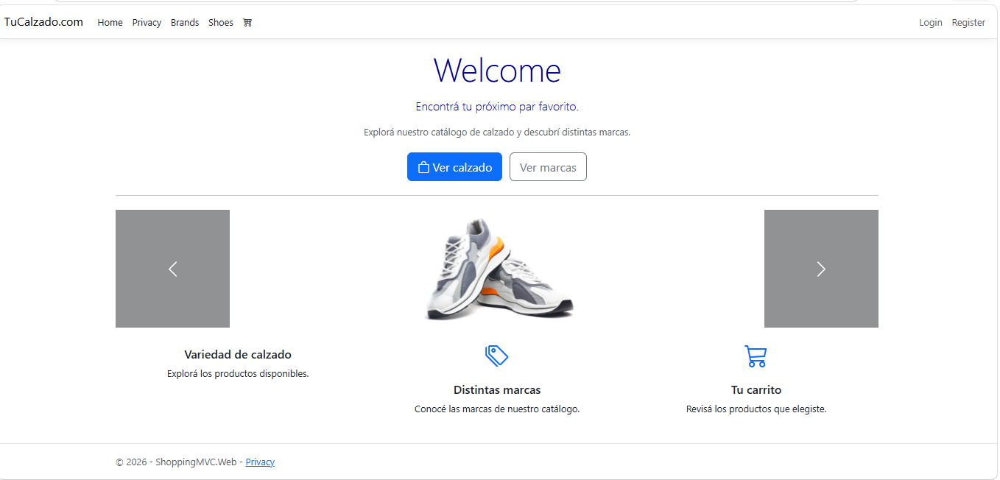
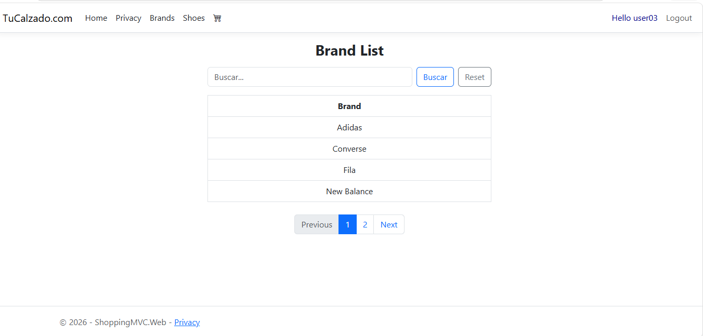
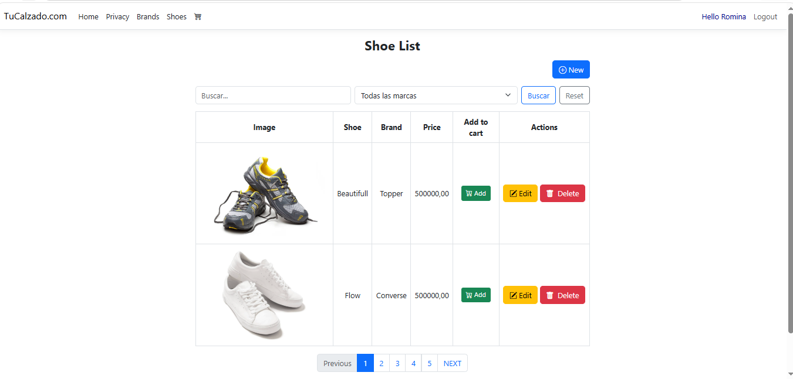
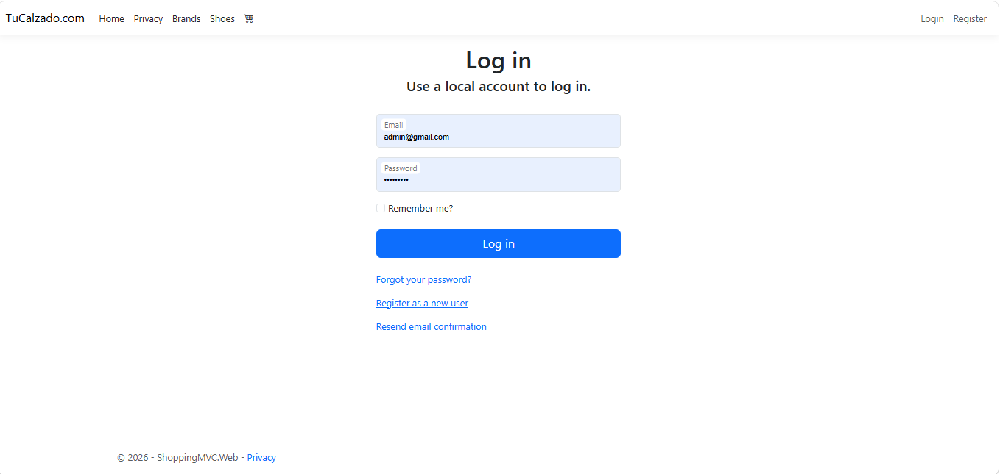
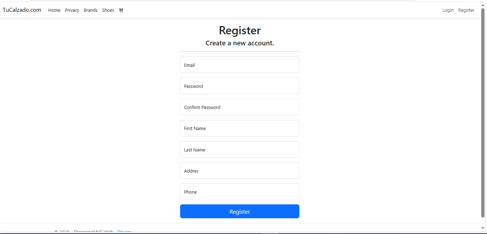
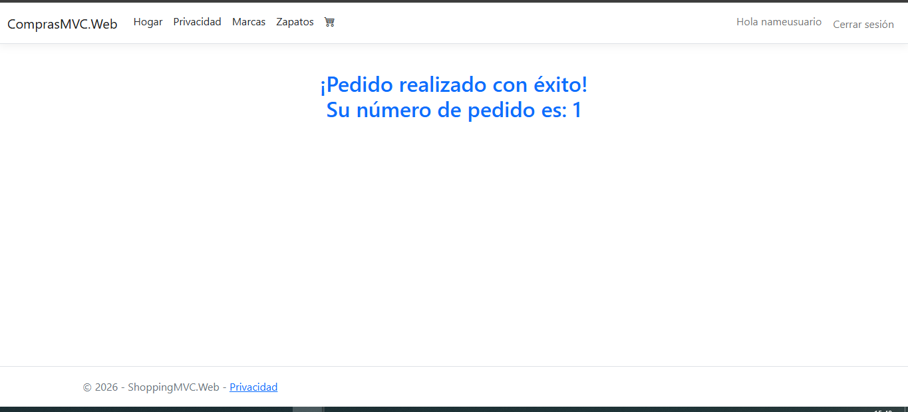

# 👟 Shoe-Brands

### Tienda Online de Calzado | ASP.NET Core MVC

---

## 💡 Sobre el proyecto

De aprender a construir.

Shoe-Brands fue mi proyecto final de carrera, desarrollado como cierre de mi formación en Análisis, Desarrollo y Programación de Aplicaciones.

El objetivo fue integrar los conocimientos adquiridos durante mis estudios en el desarrollo de una aplicación web completa, abarcando tanto la experiencia del usuario como la lógica del negocio.

La aplicación simula una tienda online de calzado, donde los usuarios pueden explorar productos, filtrarlos por marca, talle y color, agregar artículos al carrito y realizar compras.

También incorpora autenticación de usuarios y gestión de roles, con diferentes permisos para administradores y clientes.

Más que una aplicación de gestión (CRUD), Shoe-Brands fue una oportunidad para llevar la teoría a la práctica y experimentar el proceso de desarrollo de una aplicación completa, desde el diseño de la base de datos hasta la interfaz de usuario

---

### Backend

- C#
- ASP.NET Core MVC
- Entity Framework Core
- SQL Server

### Arquitectura y herramientas

- Repository Pattern
- Service Layer
- AutoMapper
- Inyección de dependencias (DI)

### Frontend

- HTML5
- CSS3
- JavaScript
- Bootstrap

### Autenticación y seguridad

- ASP.NET Core Identity
- Autorización basada en roles

---

## ✨ Funcionalidades

### 🏷️ Módulo de Marcas (CRUD)

- Crear, editar, listar y eliminar marcas.
- Validaciones y control de registros duplicados.
- Mensajes informativos para el usuario.

### 👟 Módulo de Calzado (CRUD)

- Crear, editar, listar y eliminar productos.
- Relación entre calzado y marca mediante clave foránea (FK).
- Visualización del nombre de la marca utilizando `Include` de Entity Framework Core.

### ⚙️ Funcionalidades generales

- Paginación en las vistas de listado.
- Interfaz desarrollada con Bootstrap.
- Validaciones del lado del servidor mediante Data Annotations.
- Manejo de errores y respuestas adecuadas (`NotFound`, `ModelState`, entre otros).
- Repository Pattern con soporte para filtros e inclusión de relaciones.
- Uso de `AsNoTracking()` para consultas de solo lectura.

### 🔐 Autenticación y autorización

- Autenticación de usuarios mediante ASP.NET Core Identity.
- Registro e inicio de sesión.
- Gestión de roles y permisos.
- Acceso diferenciado según el tipo de usuario.

### 🛒 Módulo de carrito de compras

- Agregar productos al carrito.
- Modificar las cantidades de los productos.
- Visualizar el contenido del carrito.
- Calcular el precio total aplicando descuentos.
- Visualizar el resumen de la compra.
- Generar y confirmar pedidos.

---

## 🗂️ Estructura del proyecto

- **Controllers:** gestionan las solicitudes HTTP y el flujo de navegación.
- **Services:** contienen la lógica de negocio y las validaciones.
- **Repository:** se encarga del acceso a datos mediante Entity Framework Core.
- **Entities / Models:** representan las entidades del sistema, como Brand y Shoe.
- **ViewModels:** contienen los modelos utilizados por las vistas.
- **Mapping Profiles:** configuran las correspondencias entre objetos mediante AutoMapper.

---

## 🔍 Detalles de implementación con Entity Framework Core

- `Include("Brand")`: permite cargar las propiedades de navegación y mostrar los nombres de las marcas en el listado de calzado.
- `AsNoTracking()`: se utiliza en consultas de solo lectura para evitar el seguimiento de cambios y mejorar el rendimiento.

---

## ▶️ Cómo ejecutar el proyecto

1. Clonar el repositorio.
2. Abrir la solución en Visual Studio.
3. Configurar la cadena de conexión de SQL Server en:
   - `appsettings.json` → `ConnectionStrings:MyConnection`
4. Aplicar las migraciones de Entity Framework Core:
   - `Update-Database`
5. Ejecutar el proyecto utilizando IIS Express o Kestrel.

---

## 📸 Galería de imágenes

- Listado de Marcas
  

- Listado de Calzado - Usuarios
  
  - Listado de Calzado - Admin
    

- Formulario de creación y edicion de calzado  
  

- Inicio de sesión
  

- Registro de usuario
  

- Confirmación de pedido
  

## 🚀 Mejoras y próximas funcionalidades

### ✔️ Implementado

- CRUD completo de marcas y productos.
- Relaciones entre entidades mediante Entity Framework Core.
- Arquitectura Repository + Service.
- Autenticación mediante ASP.NET Core Identity.
- Carrito de compras.

### 🔄 En desarrollo

- Incorporación de gestión de talles para los productos.

### 🔜 Próximas mejoras

- Gestión de stock por talle y/o color.

---

## 👩‍💻 Autora

**Romina Oviedo**  
Interesada en el desarrollo de software mantenible,
con atención tanto a la calidad técnica como a la experiencia de usuario.

- LinkedIn: www.linkedin.com/in/romina-oviedo-1b24bb2a3
